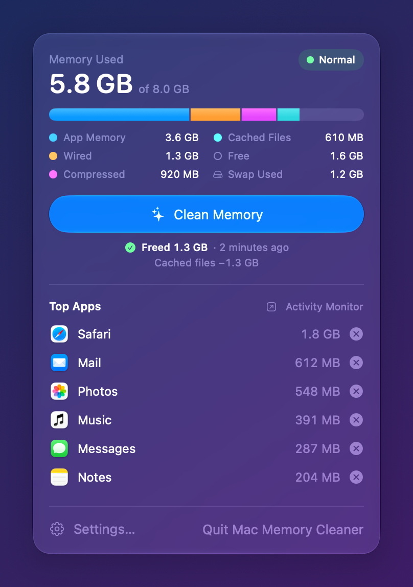

# Mac Memory Cleaner

A one-click memory cleaner for the macOS menu bar. It is a macOS take on
[Windows Memory Cleaner](https://github.com/IgorMundstein/WinMemoryCleaner): no tricks, just the
memory tools macOS already ships, behind one button.

Use it before you start something heavy, or let it clean automatically when memory runs short,
so macOS moves less memory to swap. It is made for Macs with little RAM, such as an 8 GB
MacBook Air.



## Requirements

- macOS 27 or later
- Apple silicon

## What "Clean Memory" does

The button runs three steps in order. You can turn each one off in Settings › Cleaning.

| Step | What it does | Windows Memory Cleaner equivalent |
| :--- | :--- | :--- |
| **Flush pending writes** | Runs `sync`. Writes changes that wait in RAM to the disk, so macOS can release those pages. | Modified file cache, modified page list |
| **Ask apps to release memory** | Runs `memory_pressure -S` for two seconds. This sends the same low-memory signal macOS sends when RAM runs short. Apps drop caches, memory allocators return free pages, idle system services quit, and macOS purges purgeable memory. | Working set, system file cache |
| **Purge disk cache** | Runs `purge`. Removes cached files from RAM. | Standby list |

The panel also lists the apps that hold the most memory, including their helper processes.
Quitting an app frees far more memory than any cache flush, so each app has a Quit button.
Hold Option, or right-click, to force quit.

### Proof that it works

You can check the effect yourself in Activity Monitor › Memory, or with the command line
(see below). On a test Mac, after reading 4 GB of files:

```text
Before  used 28.4 GB of 48.0 GB · free 8.2 GB  · cached files 10.5 GB · swap 3.4 GB
After   used 29.6 GB of 48.0 GB · free 16.1 GB · cached files 2.0 GB  · swap 3.0 GB
Freed 7.8 GB in 9.8 s
```

### What it cannot do

- **It cannot empty swap.** macOS reads swapped memory back only when an app needs it.
  Cleaning early, before memory runs out, is how this app keeps swap from growing.
- **macOS refills the file cache over time.** That is normal and good. Cached files make apps
  open faster. Right after a purge, apps can open files a little slower.

## Features

- **Menu bar panel** with memory used, a breakdown like Activity Monitor (app memory, wired,
  compressed, cached files, free, swap), and the memory-pressure level
- **One-click clean** with a "Freed X GB" result
- **Top apps** by memory, with Quit and Force Quit
- **Auto-clean** when macOS reports memory pressure, or when available memory falls below a
  threshold, with a minimum wait between cleans
- **Global shortcut**, by default ⌃⌥⌘M, which you can change in Settings
- **Notifications** after shortcut and automatic cleans
- **Open at login**
- **Command-line mode** for scripts, Shortcuts, and cron

## Install

### Build on the Mac that will run it

You need Xcode 27 or the Command Line Tools (`xcode-select --install`).

```sh
git clone <this repository> macmemorycleaner
cd macmemorycleaner
scripts/build.sh --install
```

The script builds `build/Mac Memory Cleaner.app`, signs it with your Apple Development or
Developer ID certificate (ad-hoc if you have none), copies it to `/Applications`, and opens it.

### Copy a build to another Mac

`scripts/build.sh` also makes `build/MacMemoryCleaner.dmg` (and a `.zip`). Open the disk image
on the other Mac and drag the app to Applications.

The build is not notarized. If the file arrived by AirDrop or download, macOS quarantines it,
and Gatekeeper blocks the first launch. To allow it, use one of these:

- Open System Settings › Privacy & Security, then click **Open Anyway**.
- Or run: `xattr -dr com.apple.quarantine "/Applications/Mac Memory Cleaner.app"`

Copying with `scp`, `rsync`, or a USB drive does not add the quarantine flag.

### First launch

1. Click the chip icon in the menu bar.
2. Click **Set Up…** and enter your password. You do this once.
3. Click **Clean Memory**.

## Admin access

`purge` and `memory_pressure -S` only run as root. Setup installs this rule as
`/etc/sudoers.d/macmemorycleaner` (owner root, mode 0440, checked with `visudo` first).
`501` is your numeric user ID:

```text
#501 ALL = (root) NOPASSWD: /usr/sbin/purge, /usr/bin/memory_pressure -S -l warn -s 2, /usr/bin/memory_pressure -S -l critical -s 2
```

The rule allows only those exact command lines, only for your account. To see the exact rule
before you set it up, run the app binary with `--show-rule`. To remove it, click **Remove…**
in Settings › Cleaning, or run `sudo rm /etc/sudoers.d/macmemorycleaner`.

## Command line

The app binary also works from Terminal:

```sh
MMC="/Applications/Mac Memory Cleaner.app/Contents/MacOS/MacMemoryCleaner"
"$MMC" --stats              # print memory use
"$MMC" --clean              # clean with the steps chosen in Settings
"$MMC" --clean --no-purge   # skip a step: --no-sync, --no-pressure, --no-purge
"$MMC" --clean --json       # machine-readable before/after report
"$MMC" --status             # is admin access set up? (exit 2 if not)
"$MMC" --show-rule          # print the sudoers rule that --setup installs
"$MMC" --setup              # set up admin access
"$MMC" --remove-setup       # remove admin access
"$MMC" --help
```

Exit status: 0 success, 1 a step failed, 2 admin access is not set up.

## Uninstall

1. Settings › Cleaning › Admin Access › **Remove…**
2. Settings › General: turn off **Open at login**.
3. Quit the app and delete it from `/Applications`.

## Development

```sh
swift build                                   # debug build
scripts/build.sh                              # signed app bundle in build/
swift scripts/make-icon.swift Resources/AppIcon.icns
"build/Mac Memory Cleaner.app/Contents/MacOS/MacMemoryCleaner" --screenshots docs
log stream --predicate 'subsystem == "com.serbinenko.MacMemoryCleaner"'
```

`--screenshots` renders the panel and every Settings tab, in light and dark mode, with live
data. With Screen Recording permission it captures real windows, so Liquid Glass renders as it
does in the app.

## Credits

Inspired by [WinMemoryCleaner](https://github.com/IgorMundstein/WinMemoryCleaner) by Igor
Mundstein.
