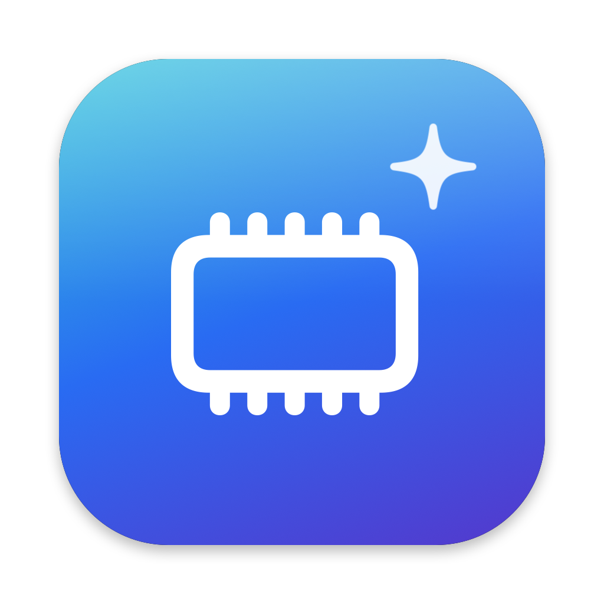
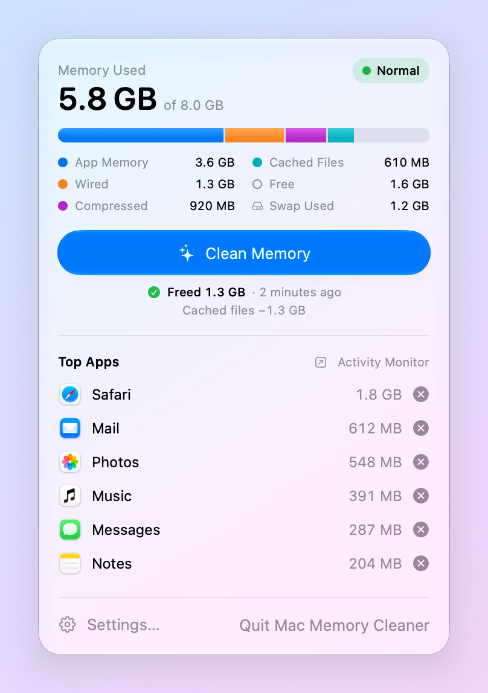
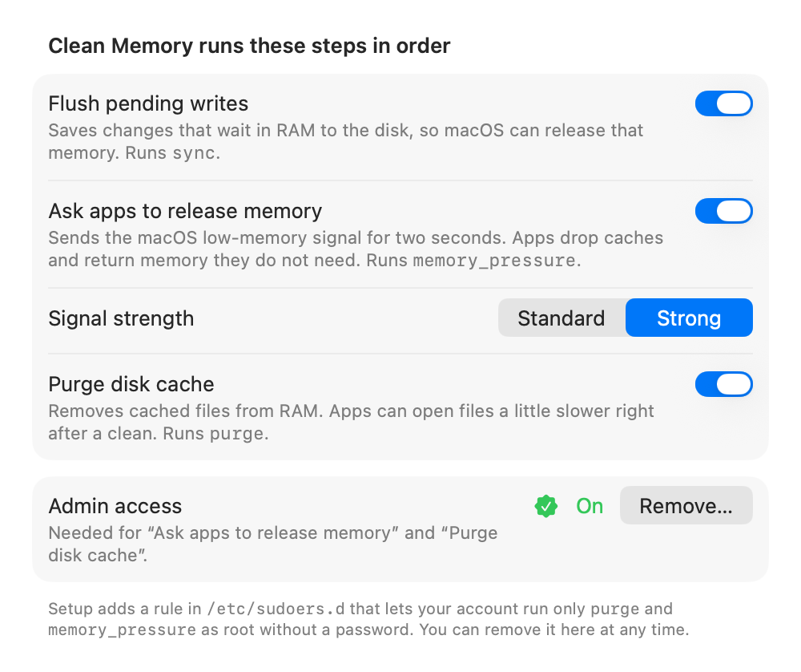

<p align="center">
  
</p>

<h1 align="center">Mac Memory Cleaner</h1>

<p align="center">
  Free up RAM with one click, right from the menu bar.<br>
  A macOS take on <a href="https://github.com/IgorMundstein/WinMemoryCleaner">Windows Memory Cleaner</a>.
</p>

<p align="center">
  <a href="https://github.com/SergeSerb2/MacMemoryCleaner/releases/latest"></a>
  
  
  <a href="https://github.com/SergeSerb2/MacMemoryCleaner/actions/workflows/ci.yml"></a>
  <a href="LICENSE"></a>
</p>

<p align="center">
  <picture>
    <source media="(prefers-color-scheme: dark)" srcset="docs/panel-dark.png">
    
  </picture>
</p>

## Why

macOS manages memory well. But on a Mac with little RAM, such as an 8 GB MacBook Air,
memory runs short fast. Then macOS compresses memory and moves it to swap on the disk, and
everything gets slower.

Mac Memory Cleaner gives you one button that runs the memory tools macOS already ships.
It clears cached files, asks every app to release memory it does not need, and shows you
which apps hold the most. Clean before you start something heavy, or let it clean
automatically when memory runs short.

There are no tricks. The app does not fill RAM to force macOS to page memory out, as some
"RAM boosters" do. It makes no network connections and collects no data.

## Features

- **Live memory view.** Memory used, a breakdown like Activity Monitor (app memory, wired,
  compressed, cached files, free, swap), and the memory-pressure level.
- **One-click clean.** The result shows how much memory was freed.
- **Top apps.** The apps that use the most memory, helper processes included, each with a
  Quit button. Quitting a large app you do not need often frees more memory than a clean.
  Hold Option, or right-click, to force quit.
- **Auto-clean.** Clean when macOS reports memory pressure, or when available memory falls
  below a level you choose.
- **Keyboard shortcut.** Clean from any app with ⌃⌥⌘M, or a shortcut you choose.
- **Notifications** after shortcut and automatic cleans.
- **Open at login.**
- **Command line** for scripts, Shortcuts, and cron.

## Install

1. Download **MacMemoryCleaner.dmg** from the
   [latest release](https://github.com/SergeSerb2/MacMemoryCleaner/releases/latest).
2. Open it, and drag **Mac Memory Cleaner** to **Applications**.
3. Open the app. macOS blocks it the first time, because the app is not notarized by Apple
   (see [FAQ](#why-does-macos-say-the-app-cannot-be-opened)). Open **System Settings ›
   Privacy & Security**, scroll down, and click **Open Anyway**. macOS asks once more:
   click **Open Anyway** again and enter your password.
4. Click the chip icon in the menu bar, then click **Set Up…** and enter your password.
   You do this only once.
5. Click **Clean Memory**.

Requires macOS 27 or later on a Mac with Apple silicon.

To check the download, put `SHA256SUMS.txt` from the release next to it and run
`shasum -a 256 -c SHA256SUMS.txt --ignore-missing`.

## How it works

**Clean Memory** runs three steps in order. You can turn each one off in **Settings ›
Cleaning**.

| Step | What it does | Windows Memory Cleaner equivalent |
| :--- | :--- | :--- |
| **Flush pending writes** | Runs `sync`. Writes changes that wait in RAM to the disk, so macOS can release those pages. | Modified file cache, modified page list |
| **Ask apps to release memory** | Runs `memory_pressure -S` for two seconds. This sends the same low-memory signal macOS sends when RAM runs short. Apps drop caches and return memory they do not need, and macOS can drop purgeable memory. **Strong** (the default) sends the critical level; **Standard** sends the warning level. | Working set |
| **Purge disk cache** | Runs `purge`. Removes cached files from RAM. | Standby list, system file cache |

### See it work

Check the effect in **Activity Monitor › Memory**:

1. Note the **Cached Files** value at the bottom of the window.
2. Open and use a few large apps, then quit them. **Cached Files** grows.
3. Click **Clean Memory**. **Cached Files** drops by about the amount the panel says it
   freed.

The panel shows where the freed memory came from, for example "Freed 1.3 GB" with
"Cached files −1.3 GB" below it. The command line shows the same numbers. A real run
on a 48 GB Mac, right after reading 4 GB of files:

```text
$ MacMemoryCleaner --clean
Flushing pending writes…
Asking apps to release memory…
Purging disk cache…

Before  used 32.2 GB of 48.0 GB · free 125 MB · cached files 14.8 GB · compressed 5.9 GB · ...
After   used 30.5 GB of 48.0 GB · free 14.5 GB · cached files 2.1 GB · compressed 5.4 GB · ...
  ✓ Flush pending writes
  ✓ Ask apps to release memory
  ✓ Purge disk cache
Freed 14.3 GB in 23.6 s (cached files −12.6 GB)
```

Most of the freed memory is usually cached files. macOS drops them on its own when an app
needs the space. A clean frees them at once, before macOS starts to compress and swap app
memory.

### What it cannot do

- **It cannot empty swap.** macOS reads swapped memory back only when an app needs it.
  Clean before memory runs out. This helps keep swap from growing.
- **macOS refills the cache.** That is normal and good: cached files make apps open
  faster. Right after a purge, apps can open files a little slower.
- **It cannot shrink an app that really needs its memory.** If one app holds most of your
  RAM, quit it from the Top Apps list.

## Admin access

`purge` and `memory_pressure -S` run only as root. The one-time setup installs a sudoers
rule that lets **your account** run **only these three exact command lines** without a
password:

```text
/usr/sbin/purge
/usr/bin/memory_pressure -S -l warn -s 2
/usr/bin/memory_pressure -S -l critical -s 2
```

The rule lives in `/etc/sudoers.d/macmemorycleaner-<your user ID>`. To see it before you
install it, run the app binary with `--show-rule`. To see every command setup runs as root,
run it with `--setup --dry-run`. To remove it, click **Remove…** in
**Settings › Cleaning**. [SECURITY.md](SECURITY.md) explains the security model and its
trade-off.

Without setup, the app still flushes pending writes, shows memory use, and lists the top
apps. If you do not want setup, click **Not Now** in the panel.

## Privacy

The app makes no network connections and collects no data. It reads memory statistics
from macOS, and it reads the memory use of apps that run as your user.

## Settings

| Tab | Options |
| :--- | :--- |
| **General** | Open at login (off), show memory used in the menu bar (on), notifications (on), keyboard shortcut (⌃⌥⌘M) |
| **Cleaning** | Turn each clean step on or off (all on), signal strength (Strong), admin access |
| **Auto-Clean** | Clean on memory pressure (on), clean when available memory falls below a level (off, 20%), wait between automatic cleans (10 minutes) |
| **About** | Version, links, and license |

<p align="center">
  <picture>
    <source media="(prefers-color-scheme: dark)" srcset="docs/settings-cleaning-dark.png">
    
  </picture>
</p>

## Command line

The app binary also works from Terminal:

```sh
MMC="/Applications/Mac Memory Cleaner.app/Contents/MacOS/MacMemoryCleaner"

"$MMC" --stats              # print memory use
"$MMC" --clean              # clean with the steps chosen in Settings
"$MMC" --clean --no-purge   # skip a step: --no-sync, --no-pressure, --no-purge
"$MMC" --clean --json       # machine-readable before-and-after report
"$MMC" --status             # is admin access set up? (exit status 2 if not)
"$MMC" --clean --pressure=standard   # gentler signal for this clean
"$MMC" --show-rule          # print the sudoers rule that --setup installs
"$MMC" --setup --dry-run    # print the commands setup runs as root, run nothing
"$MMC" --setup              # set up admin access
"$MMC" --remove-setup       # remove admin access
"$MMC" --version
"$MMC" --help
```

Exit status: 0 success, 1 a step failed or another clean was running, 2 admin access is not
set up, 64 usage error.

Only one clean runs at a time. A clean from the command line also starts the wait between
automatic cleans. So the menu bar app does not clean again right away.

## FAQ

### Does freeing memory help on macOS?

Sometimes. macOS uses free RAM as a file cache on purpose, and it drops that cache when an
app needs memory. On a Mac with plenty of RAM, you gain little. On a Mac with little RAM,
memory runs short often. Then macOS compresses and swaps app memory, even while it still
holds caches. A clean before a heavy task, or an automatic clean at the first sign of
pressure, keeps more of your apps in RAM.

### Why does "Memory Used" go back up after a clean?

Apps load their caches again as you use them. That is normal. The clean gives memory back
when you need it, for example before you open a large project or a game.

### Why does macOS say the app cannot be opened?

Apple notarizes apps only for paid developer accounts. This free build is not notarized. Click **Open Anyway** in **System Settings › Privacy & Security** once. You
can also remove the quarantine flag:
`xattr -dr com.apple.quarantine "/Applications/Mac Memory Cleaner.app"`. If you prefer, build
the app yourself from source.

### Does it work on Intel Macs or older macOS versions?

No. It needs macOS 27, and macOS 27 runs only on Apple silicon.

### The keyboard shortcut does nothing

Another app may use the same shortcut. **Settings › General** shows a warning if so. Pick a
different shortcut there. A shortcut must use ⌃ with another modifier key, or ⌥⌘, or be a
function key such as F13. So it cannot replace a standard shortcut such as ⌘W.

### I don't see the menu bar icon

On a MacBook with a notch, a full menu bar can hide icons behind the notch. Quit a few
other menu bar apps to make room. To make the icon narrower, hide the percentage with
`defaults write com.serbinenko.MacMemoryCleaner showUsageInMenuBar -bool false`, then quit
and reopen the app. The keyboard shortcut works even while the icon is hidden.

### I get no notifications

Notifications appear only while the panel is closed, so you get them for shortcut and
automatic cleans. Cleans from the command line do not notify.
If you clicked **Don't Allow** when macOS asked, **Settings › General** shows a button that
opens the notification settings for the app.

### How do I uninstall it?

1. **Settings › Cleaning › Admin access › Remove…**
2. **Settings › General**: turn off **Open at login**.
3. Quit the app, and move it from **Applications** to the Trash.
4. Optional: delete its settings with `defaults delete com.serbinenko.MacMemoryCleaner`.

If you deleted the app before you removed admin access, remove the rule by hand:
`sudo rm /etc/sudoers.d/macmemorycleaner-$(id -u)`.

## Build from source

You need Xcode 27 (tested with 27.1), or the Command Line Tools for Xcode 27
(`xcode-select --install`).

```sh
git clone https://github.com/SergeSerb2/MacMemoryCleaner.git
cd MacMemoryCleaner
scripts/build.sh --install
```

`scripts/build.sh` builds `build/Mac Memory Cleaner.app`, `build/MacMemoryCleaner.zip`, and
`build/MacMemoryCleaner.dmg`. It signs with your Developer ID or Apple Development
certificate if you have one, and ad-hoc otherwise. `--install` copies the app to
`/Applications` and opens it.

## Contributing

Bug reports and pull requests are welcome. See [CONTRIBUTING.md](CONTRIBUTING.md). Please
report security problems privately, as [SECURITY.md](SECURITY.md) describes.

## Credits

Inspired by [Windows Memory Cleaner](https://github.com/IgorMundstein/WinMemoryCleaner) by
Igor Mundstein. Mac Memory Cleaner shares its idea and its goal of transparency, not its
code.

## License

[MIT](LICENSE) © 2026 Serge Alex Serbinenko
